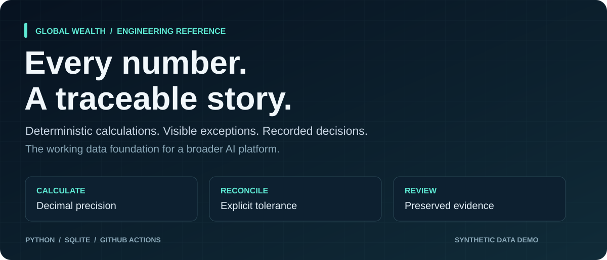
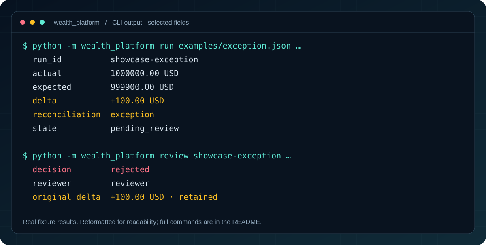
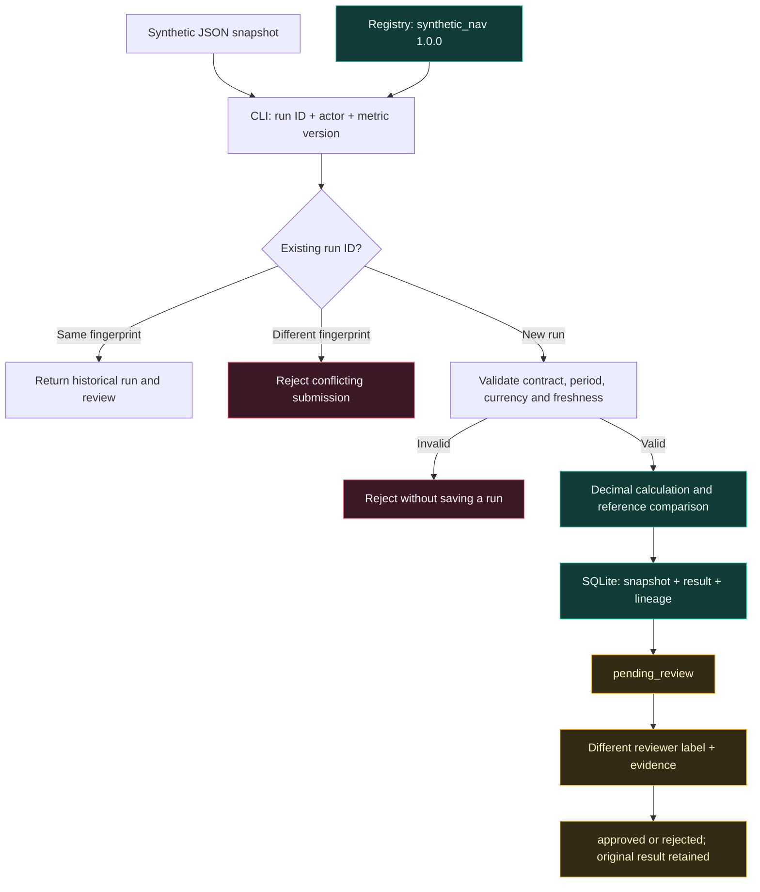

<p align="center">
  
</p>

<h1 align="center">Global Wealth AI Platform</h1>

<p align="center">
  <strong>Turn a financial calculation into a reproducible, reviewable workflow.</strong><br>
  A working Python foundation for metric definitions, reconciliation, and lineage—built with synthetic data.
</p>

<p align="center">
  <a href="https://github.com/Skeeb32/global-wealth-ai-platform/actions/workflows/ci.yml"></a>
  <a href="src/wealth_platform/core.py"></a>
  <a href="src/wealth_platform/workflow.py"></a>
  <a href="src/wealth_platform/__init__.py"></a>
</p>

<p align="center">
  <a href="https://github.com/Skeeb32/global-wealth-ai-platform/stargazers"></a>
  <a href="https://github.com/Skeeb32/global-wealth-ai-platform/forks"></a>
  <a href="https://github.com/Skeeb32/global-wealth-ai-platform/commits/main"></a>
</p>

<p align="center">
  <a href="#quick-start">Try it locally</a> ·
  <a href="#see-the-workflow">See the workflow</a> ·
  <a href="#architecture">Explore the code</a> ·
  <a href="#engineering-highlights">Engineering highlights</a> ·
  <a href="CONTRIBUTING.md">Contribute</a>
</p>

> **What you can run today:** a local CLI that validates a synthetic snapshot, calculates net asset value, checks it against a reference, and records a review in SQLite. AI retrieval, authenticated APIs, and cloud deployment are planned extensions. This is an independent reference project, not an official Carlyle product or a production financial system.

---

## Why this project exists

A number is only useful when you can explain **where it came from, which rule produced it, and what happened when it did not match expectations**.

This project makes those questions concrete. Start with one deliberately small calculation—synthetic assets minus liabilities—and follow it through validation, decimal arithmetic, reconciliation, persisted lineage, and a reviewer decision. The wider [12-month plan](docs/roadmap/12-month-plan.md) shows how that foundation could support governed data access and AI applications.

**The design principle:** deterministic code owns the calculation. Future AI capabilities should consume and explain governed results.

| A calculation alone | The implemented workflow adds |
|---|---|
| A numeric answer | A named metric, explicit version, rounding rule, and tolerance |
| A reference comparison | A preserved delta and `matched` or `exception` result |
| A rerun | Idempotent replay, or a conflict when inputs change |
| A sign-off | A reviewer label, evidence, decision, and timestamp |
| A result file | The original snapshot and source/metric hashes alongside the result |

## See the workflow

<p align="center">
  
</p>

*Selected fields from actual CLI execution, rendered for readability. This is a command-line demo, not a web dashboard. [Full commands below](#walk-through-an-exception).*

### One calculation. Two outcomes.

| Fixture | Calculated value | Reference | Delta | Reconciliation |
|---|---:|---:|---:|---|
| [`matched.json`](examples/matched.json) | $1,000,000.00 | $1,000,000.00 | $0.00 | `matched` |
| [`exception.json`](examples/exception.json) | $1,000,000.00 | $999,900.00 | +$100.00 | `exception` |

Both outcomes start in `pending_review`. Matching a reference does **not** automatically approve a run. Reviewing an exception does **not** erase the original difference.

## What is built

| Capability | Implementation detail |
|---|---|
| **Versioned definitions** | Explicit lookup of `synthetic_nav` version `1.0.0`; frozen metric definition and allowlisted formula |
| **Strict input contracts** | Required field set, synthetic flag, currency, period, identifiers, effective dates, and timezone-aware freshness checks |
| **Predictable arithmetic** | Decimal strings, a local 40-digit calculation context, half-even rounding to cents, and an inclusive $0.01 tolerance |
| **Safe replay semantics** | Same run ID and fingerprint returns the historical run; changed inputs, metric, or actor under that ID are rejected |
| **Recorded provenance** | Full source snapshot, metric definition, source/metric SHA-256 hashes, engine version, and creation timestamp |
| **Explicit review** | A different reviewer label and written evidence; final decisions through the interface, with corrections submitted as new runs |
| **Local persistence** | SQLite transactions, primary keys, a review foreign key, and parameterized queries |
| **Repeatable checks** | Standard-library tests, documentation validation, and a pinned GitHub Actions checkout with read-only repository permissions |

## Quick start

**You need:** Git and Python **3.10+** with the standard-library `sqlite3` module. There are **no third-party runtime dependencies, API keys, accounts, or cloud resources** to configure.

### 1. Clone the repository

```sh
git clone https://github.com/Skeeb32/global-wealth-ai-platform.git
cd global-wealth-ai-platform
```

### 2. Create an isolated Python environment

**macOS / Linux**

```sh
python3 -m venv .venv
source .venv/bin/activate
export PYTHONPATH=src
```

<details>
<summary><strong>Windows PowerShell</strong></summary>

```powershell
py -3 -m venv .venv
.\.venv\Scripts\Activate.ps1
$env:PYTHONPATH = "src"
```

If your machine disallows activation scripts, leave its policy unchanged and invoke `.\.venv\Scripts\python.exe` in place of `python` in the commands below.

</details>

No `pip install` step is needed. The code runs directly from `src/`; there is no package build or published package to install.

### 3. Inspect the registry and run a calculation

```sh
python -m wealth_platform metrics
python -m wealth_platform run examples/matched.json --run-id demo-match --actor analyst --as-of 2026-10-19T12:00:00Z
python -m wealth_platform show demo-match
```

The run returns JSON containing these fields:

```json
{
  "result": {
    "actual": "1000000.00",
    "expected": "1000000.00",
    "delta": "0.00",
    "tolerance": "0.01",
    "reconciliation": "matched"
  },
  "state": "pending_review"
}
```

*Excerpt only; the full response also includes the source snapshot, metric definition, and lineage.*

`--as-of` supplies a fixed evaluation clock so the dated synthetic fixtures remain reproducible. Omit it to check freshness against the current clock; these fixtures will then expire after the 24-hour window. Do not use the demo clock to claim production freshness.

### 4. Run the checks

```sh
python -m unittest discover -s tests -v
python scripts/check_docs.py
```

The current suite contains **22 tests**. It covers contract failures, rounding, tolerance boundaries, timestamps, replay, persistence, review rules, and CLI execution.

## Walk through an exception

With the environment from Quick start still active:

```sh
python -m wealth_platform run examples/exception.json --run-id demo-exception --actor analyst --as-of 2026-10-19T12:00:00Z
python -m wealth_platform review demo-exception --reviewer reviewer --decision rejected --evidence "Synthetic reference differs by 100 USD; investigate source."
python -m wealth_platform show demo-exception
python -m wealth_platform runs
```

The final run has state `rejected`, a review record, and the original `100.00` delta. Approval is also supported through `--decision approved`; an accepted exception still retains its discrepancy.

**Replay behavior:** rerunning the same calculation command returns the saved run, including its current review state. Reusing that ID with changed inputs fails. A second review fails because the first decision is final through the interface. Use a new run ID for a new attempt.

### Command reference

| Command | Purpose |
|---|---|
| `python -m wealth_platform --help` | View CLI options |
| `python -m wealth_platform metrics` | List available metric definitions |
| `python -m wealth_platform run …` | Validate, calculate, reconcile, and persist a run |
| `python -m wealth_platform review …` | Record an approval or rejection with evidence |
| `python -m wealth_platform show RUN_ID` | Read a run, lineage, and any review |
| `python -m wealth_platform runs` | List saved runs |

**Storage:** the default database is `demo.sqlite3`, excluded by `.gitignore`. To choose another file, put the global option **before** the subcommand:

```sh
python -m wealth_platform --db experiment.sqlite3 runs
```

The file is created automatically; its parent directory must already exist. No `.env` file is needed. `PYTHONPATH=src` must be set again in a new shell.

**Exit codes:** `0` means the command completed; `2` indicates invalid input or a storage error. A reconciliation exception is a valid workflow outcome, so it returns `0` and is identified in the JSON result.

## Architecture

The diagram below describes the **implemented local workflow**. The broader [target-state architecture](docs/architecture/target-state.md) is documented separately.



### Small stack, explicit responsibilities

| Layer | Technology | Source |
|---|---|---|
| Contracts and registry | Python dataclasses, validation, explicit version lookup | [`core.py`](src/wealth_platform/core.py) |
| Calculation and reconciliation | `decimal.Decimal`, half-even rounding | [`core.py`](src/wealth_platform/core.py) |
| Persistence and review | `sqlite3`, transactions, SQL constraints | [`workflow.py`](src/wealth_platform/workflow.py) |
| Provenance | Canonical JSON and `hashlib.sha256` | [`core.py`](src/wealth_platform/core.py) |
| Command-line interface | `argparse`, JSON output, error exit codes | [`__main__.py`](src/wealth_platform/__main__.py) |
| Verification | `unittest`, temporary databases, subprocess CLI tests | [`test_workflow.py`](tests/test_workflow.py) |
| Automation | GitHub Actions on Ubuntu 24.04 | [`ci.yml`](.github/workflows/ci.yml) |

<details>
<summary><strong>Repository map</strong></summary>

```text
global-wealth-ai-platform/
├── src/wealth_platform/       # Executable Python implementation
│   ├── core.py               # Contracts, registry, decimal calculations
│   ├── workflow.py           # SQLite runs, replay, and review
│   └── __main__.py           # CLI entry point
├── examples/                 # Synthetic matched and exception snapshots
├── tests/test_workflow.py    # Executable test suite
├── scripts/                  # Documentation checks and README asset renderer
├── docs/                     # Architecture, contracts, governance, roadmap
│   └── assets/               # Self-contained README SVGs
├── .github/                  # CI, CODEOWNERS, issue and PR templates
└── infra/                    # Deployment prerequisites; no provisioned resources
```

The other `src/` folders and test-category folders contain design briefs for future components. The executable implementation is in `src/wealth_platform/` and `tests/test_workflow.py`.

</details>

## Engineering highlights

**For engineers and hiring teams:** this is a compact codebase for inspecting how a developer handles correctness, state, and evidence—not just the arithmetic itself.

| Engineering challenge | Decision demonstrated | Where to inspect |
|---|---|---|
| Binary floating-point ambiguity | Accept bounded decimal strings and calculate in a local decimal context | `money()` and `calculate()` in [`core.py`](src/wealth_platform/core.py) |
| Duplicate submissions | Combine a run ID with a fingerprint and serialize writes using `BEGIN IMMEDIATE` | `Workflow.submit()` in [`workflow.py`](src/wealth_platform/workflow.py) |
| Reproducing a historical result | Persist the original snapshot, metric definition, versions, and hashes | Run payload in [`workflow.py`](src/wealth_platform/workflow.py) |
| Review without rewriting history | Store review separately; preserve the calculation and reject repeat decisions | `Workflow.review()` in [`workflow.py`](src/wealth_platform/workflow.py) |
| Testing beyond the happy path | Exercise invalid contracts, conflicting replay, persistence, and real CLI subprocesses | [`test_workflow.py`](tests/test_workflow.py) |
| Connecting code to delivery | Document contracts, control requirements, architecture decisions, and acceptance gates | [Documentation guide](#documentation-guide) |

The project demonstrates **Python backend engineering, financial-data validation, SQL persistence, workflow modeling, automated testing, and architecture documentation**. It makes no throughput, production-scale, or measured business-savings claims.

## Project health and evidence

| Signal | What it means |
|---|---|
| [Foundation CI](https://github.com/Skeeb32/global-wealth-ai-platform/actions/workflows/ci.yml) | Live build status; runs the executable suite and documentation checks |
| [22 tests](tests/test_workflow.py) | Current test-method count, not a coverage percentage |
| [Engine 0.1.0](src/wealth_platform/__init__.py) | Source version; not a claim of a published release |
| Zero external runtime dependencies | Uses Python's standard library; no runtime dependency installation |
| [Commit history](https://github.com/Skeeb32/global-wealth-ai-platform/commits/main) | Inspect the actual evolution of the project |
| [Maintainer: @Skeeb32](https://github.com/Skeeb32) | Repository ownership is declared in [CODEOWNERS](.github/CODEOWNERS) |

Star, fork, and activity badges above report live GitHub data. Coverage reporting and performance benchmarks are not configured. CI is included; branch protection and deployment environments are not provisioned by the repository files.

## Roadmap

### Built and runnable

- [x] Versioned synthetic metric and strict snapshot contract
- [x] Deterministic calculation and tolerance-based reconciliation
- [x] SQLite persistence, lineage, and idempotent replay
- [x] Reviewer decisions with evidence
- [x] CLI examples, 22 tests, and GitHub Actions checks
- [x] Architecture, discovery, governance, and delivery planning

### Proposed next milestones

- [ ] Define a business-approved metric and reference test corpus
- [ ] Add authenticated identities, authorization, and exception policies
- [ ] Introduce database migrations, retention, and recovery validation
- [ ] Expose governed metric access through an API
- [ ] Build permission-aware retrieval and citation evaluations
- [ ] Add controlled infrastructure and deployment workflows

These are planned directions, not currently running integrations or delivery commitments. See the [first 90 days](docs/product/first-90-days.md) and [12-month build plan](docs/roadmap/12-month-plan.md) for dependencies and acceptance gates.

## Documentation guide

| If you want to… | Read |
|---|---|
| Understand demo behavior and limits | [Working demo](docs/product/working-demo.md) |
| Inspect the proposed platform design | [Target-state architecture](docs/architecture/target-state.md) |
| Define an authoritative metric | [Metric registry contract](docs/data/metric-registry-schema.md) |
| Evaluate a candidate workflow | [Discovery inventory](docs/discovery/process-inventory.md) · [Prioritization](docs/product/use-case-prioritization.md) |
| Connect requirements to evidence | [Control matrix](docs/governance/control-matrix.md) |
| Configure repository controls | [GitHub setup checklist](docs/governance/github-setup.md) |
| Understand repository boundaries | [Repository strategy ADR](docs/decisions/ADR-0001-repository-strategy.md) |
| Prepare for operations | [Pilot runbook](docs/runbooks/pilot-operations.md) |

## Contribute

A useful contribution can be small: a missing edge case, clearer error message, documentation correction, or well-scoped proposal from the roadmap.

1. [Open an issue](https://github.com/Skeeb32/global-wealth-ai-platform/issues/new/choose) describing the problem and acceptance criteria.
2. Fork the repository, clone your fork, and follow [Quick start](#quick-start).
3. Create a branch such as `git switch -c docs/improve-example`.
4. Keep the change focused. Add behavioral tests for code changes and use synthetic fixtures.
5. Run both verification commands and open a pull request with the results.

Read [CONTRIBUTING.md](CONTRIBUTING.md) and the [PR template](.github/pull_request_template.md) for business impact, risk, and review expectations. To regenerate the showcase assets from a fresh demo run:

```sh
python scripts/render_readme_assets.py
```

## Scope, security, and licensing

- **Local prototype:** actors and reviewers are self-declared labels, not authenticated identities. SQLite is editable by its local owner; provenance hashes are not a tamper-proof audit trail.
- **Synthetic data only:** the `synthetic` flag is an input assertion, not a data-loss-prevention system. Do not submit investor information, credentials, production extracts, or confidential documents. Follow [SECURITY.md](SECURITY.md) for private reporting guidance.
- **Deployment:** there is no package build, container image, hosted demo, cloud provisioning, or production deployment workflow. Use the local CLI; [infrastructure prerequisites](infra/README.md) describe what needs to be decided next.
- **Independent project:** the supplied Carlyle-oriented plan is reference material. This repository is not affiliated with or endorsed by Carlyle, and does not describe verified internal systems.
- **License status:** no license file is currently included. No open-source license is claimed or granted by this README.

---

<p align="center">
  <strong>Make the result reproducible. Make the decision visible.</strong><br><br>
  If this approach is useful, <strong>⭐ star the repository</strong>.<br>
  <a href="https://github.com/Skeeb32/global-wealth-ai-platform/fork">Fork it</a> ·
  <a href="#quick-start">Run the demo</a> ·
  <a href="https://github.com/Skeeb32/global-wealth-ai-platform/issues/new/choose">Suggest an improvement</a> ·
  <a href="CONTRIBUTING.md">Contribute a change</a>
</p>
