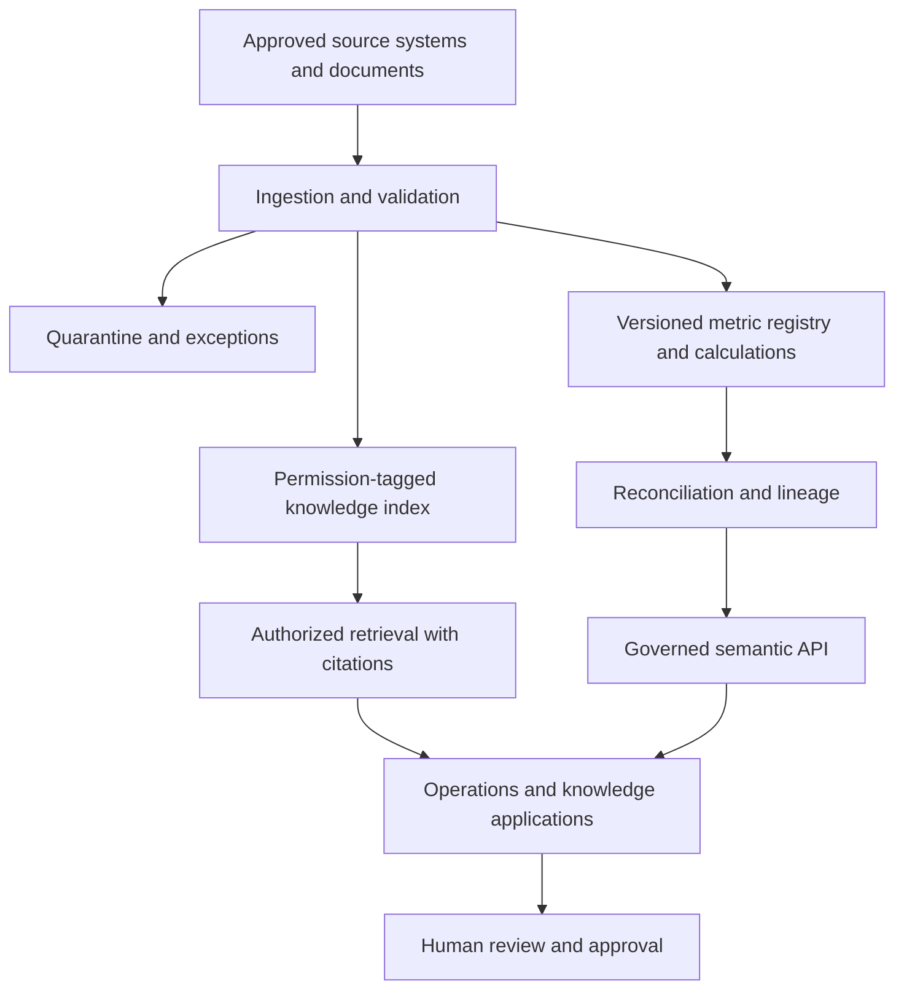

# Target-state architecture

Status: proposed reference architecture; service and hosting selections are not approved enterprise decisions.

Deterministic code owns authoritative financial calculations. LLMs retrieve, explain, and assist; their output is not an approved calculation rule. Trusted values, definitions, procedures, and unverified narrative remain distinguishable.

Every run records source snapshot, contract version, calculation version, run ID, result, and review evidence. Authorization must constrain retrieval before content is exposed, and must also apply to metric APIs. Invalid or stale inputs enter a controlled exception path.

AWS S3, Lambda, Step Functions, ECS, relational storage, and API Gateway are candidate services from the plan. Select only those justified by workload, existing standards, operational support, and cost. Define retries, timeouts, idempotency, recovery, and rollback before production.

Open decisions: pilot metric, source authority, identity provider, hosting, database, model provider, retention, team ownership, and production approval process.
